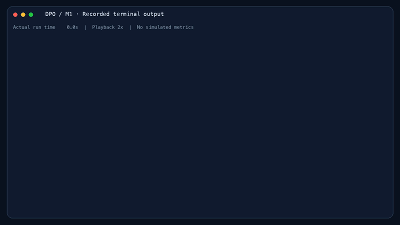
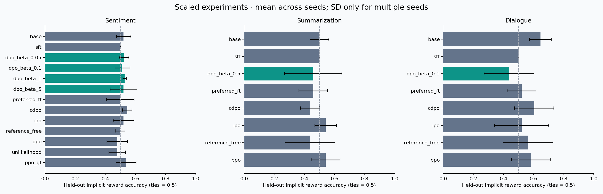
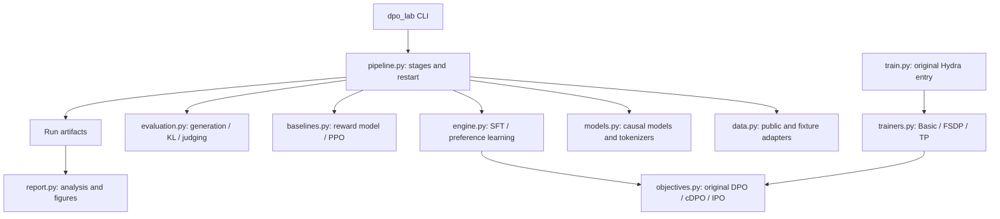

# DPO Mac Lab

**English** | [简体中文](README.zh-CN.md)

An end-to-end Direct Preference Optimization toolkit for Apple Silicon, preserving the original DPO objective with MPS-accelerated training, reproducible experiments, baseline comparisons, and evaluation.

Train a language model from preferences on an M1 Mac: **supervised fine-tuning → frozen reference → DPO → evaluation**, with full-parameter updates and reproducible local artifacts.

Based on [Direct Preference Optimization: Your Language Model is Secretly a Reward Model](https://arxiv.org/abs/2305.18290). The original Hydra training interface, cDPO/IPO extensions, and distributed trainers remain available. [Original README](docs/UPSTREAM_README.md) · [Architecture](docs/ARCHITECTURE.md) · [Paper coverage audit](docs/PAPER_REPRODUCTION.md).

> **Scope:** the M1 profile runs reduced public-data experiments. It does **not** reproduce the paper's full model sizes, numerical tables, historical GPT-4 judgments, or human study. Synthetic smoke tests are labeled separately. See the coverage audit for every remaining gap.

## Demo

[](docs/media/demo.mp4)

**[Watch / download the MP4](docs/media/demo.mp4)** · [Terminal recording](docs/media/demo.cast) · [Recording metadata](docs/media/demo.json)

The recording first executes all three task pipelines with **synthetic fixtures and a tiny random transformer**, then loads **real GPT-2 checkpoints trained on public data** and generates new continuations. It uses 2× playback. Fixture scores and public-data measurements are clearly separated; neither is a claim of paper-level quality. The linked MP4 works in a video player; the GIF provides an inline preview where README video tags are unsupported.

## Quick start on M1

Run the following commands from the repository root.

Validated hardware: **Apple M1 Pro, 16 GB unified memory, native arm64 Python 3.11, macOS 26.6.1**. Use a recent macOS supported by the pinned PyTorch build; CPU is also supported. No CUDA, W&B login, paid API, quantization library, or model service is required.

```bash
python3.11 -m venv .venv
source .venv/bin/activate
python -m pip install --upgrade pip
python -m pip install -r requirements.txt
python -m pip install -e . --no-deps
python -m dpo_lab doctor
```

`doctor` should report `machine: arm64`, `mps_available: true`, and `device: mps`. Dependencies are pinned; the complete tested environment is in [requirements-lock-macos-arm64.txt](requirements-lock-macos-arm64.txt).

Run the entire small offline workflow, then generate its report:

```bash
python -m dpo_lab run --config experiments/smoke.json --output artifacts/my-smoke
python -m dpo_lab report artifacts/my-smoke
```

The smoke profile builds its own tokenizer/model and uses explicitly synthetic data. After installing dependencies it needs no network. Choose a new output path for a new run. Add `--device cpu` to test the CPU path; `--device mps` requires a working Metal device and fails explicitly if unavailable.

## Real public-data experiments

```bash
# Download only the bounded dataset selections; record revisions and hashes.
python -m dpo_lab prepare --config experiments/mac.json --output artifacts/public-data

# Train and evaluate sequentially on this Mac.
python -m dpo_lab run --config experiments/mac.json \
  --data artifacts/public-data --output artifacts/my-public-run --device mps

# Create Markdown, CSV, aggregate JSON and figures.
python -m dpo_lab report artifacts/my-public-run
```

Initial use downloads public model weights and dataset files. Models are cached by Hugging Face. Large checkpoints remain on disk and are ignored by Git; raw selected data, metrics, reports, configuration and evaluation samples are retained in the run directory. Public datasets can contain sensitive or offensive material; generated text is unfiltered research output.

| Setting | M1 public profile |
|---|---|
| Causal model | Pythia-70M-deduped; full parameters, FP32 |
| Tasks | IMDb sentiment, TL;DR summarization, HH single-turn dialogue |
| Additional evaluation | CNN/DailyMail summarization distribution shift |
| Training seeds | 0, 1, 2; fixed data-selection seed 42 |
| Selected source examples | 64 training / 16 held-out per task |
| Sentiment preferences | 16 prefixes × 4 SFT samples; up to 96 pairs per split |
| Context / generation | 128 total tokens; prompt ≤88; generation ≤24 |
| Logical / micro batch | 4 / 1 |
| Training | One SFT and one preference epoch; RMSprop |
| DPO β | Sentiment: 0.05, 0.1, 1, 5; summaries: 0.5; dialogue: 0.1 |
| Baselines / extensions | Base, SFT, Preferred-FT, cDPO, IPO, reference-free, PPO, Best-of-1/4; sentiment also unlikelihood and PPO-GT |
| Generation temperatures | 0, 0.25, 1.0; four held-out prompts |

For a smaller matrix using GPT-2 and the paper's 1e-6 learning rate / 150-step warmup, use [experiments/gpt2-mac.json](experiments/gpt2-mac.json):

```bash
python -m dpo_lab run --config experiments/gpt2-mac.json \
  --data artifacts/public-data --output artifacts/my-gpt2-run --device mps
python -m dpo_lab report artifacts/my-gpt2-run
```

This is a separate one-seed diagnostic, with fewer baselines. It retains EOS in the original objective. The Pythia matrix exposed a very low EOS probability and repetitive outputs; see [the numerical investigation](docs/VALIDATION.md). The original Hydra entry now defaults to GPT-2 and smaller context/evaluation batches; all larger settings remain configurable.

Change [experiments/mac.json](experiments/mac.json) to scale a run. Short contexts, small datasets and small models constrain generation quality. More training does not automatically reproduce the original study.

Resume a run with unchanged source, configuration, packages and device:

```bash
python -m dpo_lab run --config experiments/mac.json \
  --data artifacts/public-data --output artifacts/my-public-run --device mps --resume
```

Completed stages and caches are verified by SHA-256. Interrupted stages restart from their input checkpoint. This is **stage-level restart**, not exact mid-update recovery. Changed experiments need a new output directory.

## Saved experiments and interpretation

- [Evidence overview](results/README.md), including negative results and scope limits.
- [Public-data report](results/m1-public/REPORT.md): actual M1 experiments, seed-level results, plots and limitations.
- [Additional GPT-2 report](results/gpt2-public/REPORT.md).
- [Public run configuration and environment](results/m1-public/manifest.json).
- [Selected dataset provenance](results/m1-public/data/manifest.json).
- [MPS smoke report](results/smoke-mps/REPORT.md) and [CPU smoke report](results/smoke-cpu/REPORT.md).
- [Numerical CPU/MPS validation and cache timing](docs/VALIDATION.md), including failed strict GPT-2 comparisons.

The reference-cache microbenchmark measured **1.25× forward/backward throughput** on GPT-2 (0.124 → 0.099 seconds per pair), excluding cache construction and optimizer updates. All 18 unit tests passed. GPT-2 exceeded the strict 2% per-parameter CPU/MPS gradient threshold in two cases (maximum 2.121%; whole-model error 0.056%); those failures are retained in the validation record.



**Read the metrics correctly.** Preference accuracy measures the implicit reward's ordering of existing held-out pairs. It is not a human/GPT-4 generation win rate. The SFT reference has tied implicit rewards and receives 0.5 by construction. Summarization/dialogue learned rewards and lexical overlap are diagnostics. Small models may generate incoherent responses even when preference loss improves.

Sequence KL is measured only from untempered policy samples using the sum of exact vocabulary-level conditional KL values at sampled prefixes. Tempered and Best-of-N samples are not mislabeled as this policy KL. See the report for uncertainty and small-sample caveats.

## Data flow

```mermaid
flowchart LR
    Public[Versioned public datasets] --> Select[Bounded sampling + split checks]
    Fixture[Explicit synthetic fixtures] --> Select
    Select --> SFTData[Task SFT examples]
    SFTData --> SFT[Supervised fine-tuning]
    SFT --> Ref[Frozen SFT reference]
    SFT --> Init[Initialize policy from SFT]
    Select --> Human[Human preference pairs]
    SFT --> Samples[IMDb: sample 4 responses per prefix]
    Samples --> Oracle[Sentiment classifier ranking]
    Oracle --> Pairs[Chosen / rejected pairs]
    Human --> Pairs
    Pairs --> Tokens[Tokenize + mask prompt/padding + EOS]
    Ref --> Cache[Cache reference log probabilities]
    Tokens --> Cache
    Tokens --> Loss[DPO loss]
    Cache --> Loss
    Init --> Loss
    Loss --> Update[Microbatches + RMSprop]
    Update --> Eval[Held-out pairs / generation / KL / OOD]
    Eval --> Evidence[JSONL + checkpoints + CSV + plots]
```



DPO itself does not train a reward model or sample responses during preference updates. Sentiment preference construction happens beforehand. Explicit reward learning and PPO belong to the comparison baselines.

## Code and execution structure



```text
config/                     Original Hydra configs; M1 model and IPO added
experiments/                Explicit smoke and public-data experiment profiles
dpo_lab/                    Local training, baselines, evaluation, reporting
scripts/                    Demo recording, numerical parity and timing tools
tests/                      Mathematical, data, cache and runtime regression tests
results/                    Actual experiment evidence and reports
docs/                       Paper audit, architecture, upstream README and video
train.py                    Compatible original training entry
trainers.py                 Original trainer classes with MPS/CPU support
preference_datasets.py      Original HH/SHP/SE and local JSONL support
```

## The unchanged DPO objective

For chosen response `y_w`, rejected response `y_l`, and a fixed SFT reference:

$$
\mathcal L_{DPO}=-\mathbb E\log\sigma\left(\beta\left[
\log\pi_\theta(y_w|x)-\log\pi_{ref}(y_w|x)
-\log\pi_\theta(y_l|x)+\log\pi_{ref}(y_l|x)\right]\right).
$$

DPO sums response token log-probabilities; prompt/padding tokens are excluded. cDPO adds label smoothing. IPO uses **average** response token log-probabilities with its squared objective. The frozen-reference cache is mathematically identical to running the reference forward pass for the same tokens and weights; an equivalence test checks gradients.

## Original Hydra interface

The original datasets `hh`, `shp`, `se` and CUDA trainer classes remain available. A local dataset directory may contain `train.jsonl` and `test.jsonl` rows with `prompt`, `chosen`, and `rejected` strings. This allows a bounded M1 run without loading all HH data:

```bash
python train.py model=gpt2 loss=sft device=mps \
  datasets='[artifacts/public-data/dialogue]' exp_name=local_sft \
  batch_size=4 gradient_accumulation_steps=4 eval_batch_size=2 \
  max_length=128 max_prompt_length=88 n_eval_examples=16 \
  sample_during_eval=false local_run_dir=artifacts/hydra-sft

python train.py model=gpt2 loss=dpo loss.beta=0.1 device=mps \
  model.archive=artifacts/hydra-sft/LATEST/policy.pt \
  datasets='[artifacts/public-data/dialogue]' exp_name=local_dpo \
  batch_size=4 gradient_accumulation_steps=4 eval_batch_size=2 \
  max_length=128 max_prompt_length=88 n_eval_examples=16 \
  sample_during_eval=false local_run_dir=artifacts/hydra-dpo
```

Use `loss=ipo` for IPO or `loss.label_smoothing=0.1` for cDPO. `eval_every` is measured in examples. W&B is off by default. FSDP and TensorParallel require CUDA; install the optional `tensor-parallel` dependency only for that legacy trainer. These distributed paths are retained but not hardware-validated on this Mac.

## Generate from a saved model

The local experiment runner saves standard Hugging Face model directories:

```bash
python -m dpo_lab generate \
  --model artifacts/my-public-run/seed_0/dialogue/dpo_beta_0.1/model \
  --prompt $'\n\nHuman: How can I learn to cook?\n\nAssistant:' \
  --task dialogue --device mps --max-new-tokens 48
```

Run the public experiment first if weights are absent after cloning. Git intentionally excludes the large weights. Hydra's `policy.pt` format remains available for its original training path.

## External judgments, tests and demo regeneration

Blinded A/B forms are exported next to generation samples. Fill real judgments and evaluator provenance, then import them with `python -m dpo_lab judge --help`. `python -m dpo_lab agreement --help` compares aligned independent judgment files. Neither command fabricates labels or calls a paid service. [Evaluation procedure](docs/PAPER_REPRODUCTION.md).

```bash
python -m pytest -q
python scripts/check_device_parity.py \
  --data results/m1-public/data/dialogue/train.jsonl \
  --output artifacts/device-parity.json

# Requires ffmpeg on PATH; records actual execution, then renders MP4/GIF.
# The demo creates a new timestamped directory under artifacts/.
# Omit --public-results for the offline-only recording; public weights must exist.
python scripts/record_demo.py --output docs/media/demo --speed 2 -- \
  python -u scripts/demo.py --public-results results/gpt2-public
```

If memory is constrained, keep `microbatch_size=1`, shorten contexts, enable `gradient_checkpointing`, or use CPU. Reducing logical batch size changes optimization and should be recorded as a different experiment. This project pins PyTorch 2.15 after an older 2.6 MPS run exhibited invalid gradients; use the tested environment and inspect numerical parity when changing it.

## Citation and license

The original code retains its [Apache-2.0 license](LICENSE). The repository's initial [MIT notice](LICENSE-MIT) is also preserved; it does not replace the upstream license. Dataset/model licenses remain with their respective authors.

```bibtex
@inproceedings{rafailov2023direct,
  title={Direct Preference Optimization: Your Language Model is Secretly a Reward Model},
  author={Rafailov, Rafael and Sharma, Archit and Mitchell, Eric and
          Manning, Christopher D. and Ermon, Stefano and Finn, Chelsea},
  booktitle={Advances in Neural Information Processing Systems},
  year={2023},
  url={https://arxiv.org/abs/2305.18290}
}
```
