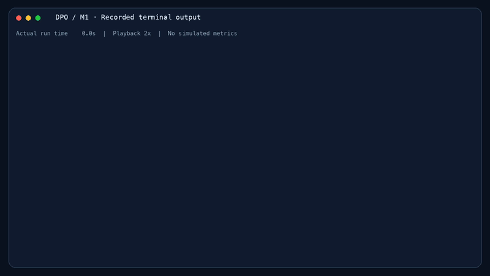
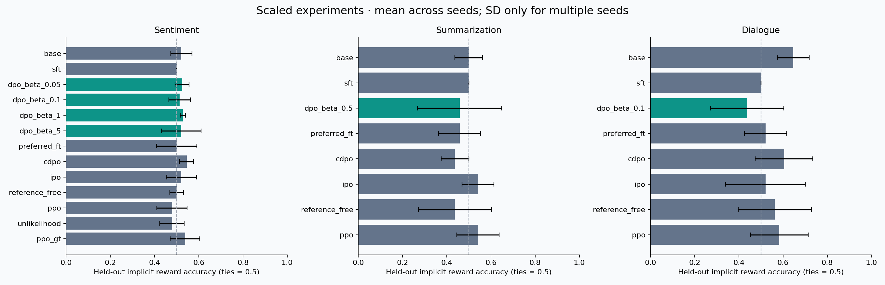
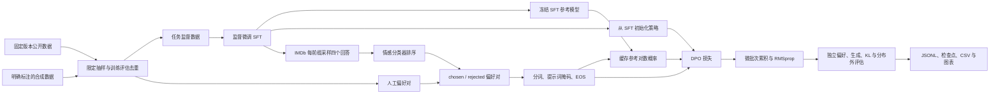
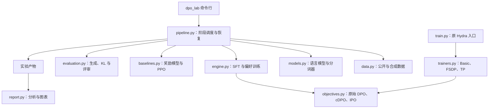

# DPO Mac Lab

[English](README.md) | **简体中文**

面向 Apple Silicon 的端到端 Direct Preference Optimization 工具包，保留原始 DPO 目标，提供 MPS 加速训练、可复现实验、基线对照和评估。

在 M1 Mac 上完整运行 **监督微调（SFT）→ 固定参考模型 → DPO → 评估**。保留全参数训练，并保存可追溯的本地实验数据。

本项目基于论文 [Direct Preference Optimization: Your Language Model is Secretly a Reward Model](https://arxiv.org/abs/2305.18290)。原有 Hydra 训练入口、cDPO／IPO 扩展和分布式训练器继续保留。[原版 README](docs/UPSTREAM_README.md) · [代码结构](docs/ARCHITECTURE.md) · [论文复现覆盖审计](docs/PAPER_REPRODUCTION.md)。

> **复现范围：** M1 配置运行的是公开数据上的缩小规模实验，不能等同于论文中的完整模型规模、数值结果、历史 GPT-4 评审和人工研究。合成数据测试单独标注，所有未完成的论文实验均在覆盖审计中明确列出。

## 运行演示

[](docs/media/demo.mp4)

**[播放／下载 MP4](docs/media/demo.mp4)** · [原始终端记录](docs/media/demo.cast) · [录像元数据](docs/media/demo.json)

视频先使用**合成测试数据和随机初始化的小型 Transformer**运行三类任务的完整流程，再加载**使用公开数据训练的真实 GPT-2 检查点**进行新的生成。以 2 倍速播放，明确区分合成测试分数与公开数据指标，不宣称达到论文模型质量。README 无法直接播放视频的平台仍可显示 GIF 预览。

## M1 快速开始

请在仓库根目录执行以下命令。

实际验证环境：**Apple M1 Pro、16 GB 统一内存、arm64 Python 3.11、macOS 26.6.1**。请使用固定版本 PyTorch 支持的较新 macOS；也支持 CPU。无需 CUDA、W&B 账号、付费 API、量化库或外部模型服务。

```bash
python3.11 -m venv .venv
source .venv/bin/activate
python -m pip install --upgrade pip
python -m pip install -r requirements.txt
python -m pip install -e . --no-deps
python -m dpo_lab doctor
```

正常情况下，`doctor` 显示 `machine: arm64`、`mps_available: true`、`device: mps`。直接依赖已固定版本，完整环境见 [requirements-lock-macos-arm64.txt](requirements-lock-macos-arm64.txt)。

运行整个离线测试流程并生成分析报告：

```bash
python -m dpo_lab run --config experiments/smoke.json --output artifacts/my-smoke
python -m dpo_lab report artifacts/my-smoke
```

此配置在本地创建 tokenizer 和模型，使用明确标注的合成数据。安装依赖后无需联网。新实验请使用新的输出目录；添加 `--device cpu` 可验证 CPU 路径。显式指定 `--device mps` 时，若 Metal 不可用会直接报错。

## 公开数据实验

```bash
# 获取限定数量的数据，保存来源版本和文件哈希。
python -m dpo_lab prepare --config experiments/mac.json --output artifacts/public-data

# 在本机按顺序训练和评估。
python -m dpo_lab run --config experiments/mac.json \
  --data artifacts/public-data --output artifacts/my-public-run --device mps

# 生成 Markdown、CSV、汇总 JSON 和图表。
python -m dpo_lab report artifacts/my-public-run
```

首次运行会下载公开模型和数据文件，模型由 Hugging Face 缓存。大型模型检查点保留在本地，但由 Git 忽略；选定的数据、指标、报告、配置和生成样本保存在实验目录中。公开数据可能包含敏感或冒犯性内容，生成文本属于未过滤的研究输出。

| 项目 | M1 公开数据配置 |
|---|---|
| 语言模型 | Pythia-70M-deduped；FP32 全参数训练 |
| 任务 | IMDb 情感控制、TL;DR 摘要、HH 单轮对话 |
| 额外评估 | CNN/DailyMail 摘要分布外生成 |
| 训练随机种子 | 0、1、2；数据抽样种子固定为 42 |
| 数据量 | 每任务选取 64 条训练、16 条独立评估来源样本 |
| 情感偏好构造 | 每个划分选取 16 个前缀，每前缀采样 4 个回答，最多形成 96 对 |
| 长度 | 总长度 128 token；提示词最多 88；生成最多 24 |
| 逻辑／微批次 | 4／1 |
| 优化 | SFT 和偏好训练各一轮；RMSprop |
| DPO β | 情感：0.05、0.1、1、5；摘要：0.5；对话：0.1 |
| 对照与扩展 | Base、SFT、Preferred-FT、cDPO、IPO、无参考 DPO、PPO、Best-of-1/4；情感任务另含 Unlikelihood 和 PPO-GT |
| 生成温度 | 0、0.25、1.0；4 个独立评估提示词 |

还提供使用 GPT-2、论文中的 1e-6 学习率与 150 步预热的较小实验矩阵：

```bash
python -m dpo_lab run --config experiments/gpt2-mac.json \
  --data artifacts/public-data --output artifacts/my-gpt2-run --device mps
python -m dpo_lab report artifacts/my-gpt2-run
```

[GPT-2 配置](experiments/gpt2-mac.json)只运行一个随机种子和较少的基线，仍保留原始目标中的 EOS。Pythia 矩阵暴露了极低 EOS 概率与重复生成，详见[数值调查](docs/VALIDATION.md)。原 Hydra 入口现默认使用 GPT-2 和更小的上下文／评估批次，仍可配置为较大规模。

可修改 [experiments/mac.json](experiments/mac.json) 扩大实验规模。短上下文、小数据和小模型会限制生成质量；仅增加训练量也不能自动等同于原论文复现。

在源代码、配置、依赖和设备均未变化时恢复执行：

```bash
python -m dpo_lab run --config experiments/mac.json \
  --data artifacts/public-data --output artifacts/my-public-run --device mps --resume
```

程序校验已完成阶段与缓存的 SHA-256 后跳过这些阶段。未完成阶段会从输入检查点重新执行。这是**阶段级恢复**，并非优化器更新中途的精确恢复。配置发生变化时请另建输出目录。

## 已保存的实验与结果解读

- [中文实验分析概览](results/README.zh-CN.md)，包含负面结果与复现边界。
- [公开数据实验报告](results/m1-public/REPORT.md)：真实 M1 运行、各随机种子结果、图表和局限。
- [额外的 GPT-2 实验报告](results/gpt2-public/REPORT.md)。
- [配置及运行环境](results/m1-public/manifest.json)。
- [数据版本与哈希](results/m1-public/data/manifest.json)。
- [MPS 离线测试报告](results/smoke-mps/REPORT.md)与 [CPU 离线测试报告](results/smoke-cpu/REPORT.md)。
- [CPU/MPS 数值对照与缓存性能测量](docs/VALIDATION.md)，包含未通过的 GPT-2 严格对照。

参考模型缓存的 GPT-2 微基准测得**前向／反向吞吐量约为原来的 1.25 倍**（每对 0.124 → 0.099 秒），不含缓存构造和优化器更新。18 项单元测试全部通过。GPT-2 的两组 CPU/MPS 对照超过了单参数梯度误差 2% 的严格阈值（最大 2.121%，整体梯度误差 0.056%），失败记录已保留。



**不要混淆指标含义。** 偏好准确率衡量隐式奖励对已有 chosen/rejected 答案的排序，不是人类或 GPT-4 对生成答案的胜率。SFT 与参考模型相同，因此隐式奖励相同，平局按 0.5 计分。摘要和对话的学习奖励、词汇重叠率仅用于诊断。偏好损失改善时，小模型仍可能输出不连贯文本。

序列 KL 仅对未经温度变换的策略采样计算：沿采样前缀对每一步完整词表的条件 KL 求和。温度采样和 Best-of-N 结果不会冒充这一策略 KL。请结合报告中的样本量和不确定性说明解读结果。

## 数据流图



DPO 偏好更新本身不训练奖励模型，也不在线采样回答。IMDb 的偏好生成发生在训练前；显式奖励模型和 PPO 仅用于对照实验。

## 结构流程图



```text
config/                     原 Hydra 配置，新增 M1 模型与 IPO 配置
experiments/                离线测试和公开数据实验配置
dpo_lab/                    本地训练、对照、评估、报告
scripts/                    视频录制、设备数值对照与计时工具
tests/                      数学、数据、缓存与运行时回归测试
results/                    真实实验数据和分析结果
docs/                       论文审计、架构、原 README 和视频
train.py                    兼容原项目的训练入口
trainers.py                 保留原训练器，增加 MPS/CPU 支持
preference_datasets.py      原 HH/SHP/SE 与本地 JSONL 数据支持
```

## 保留原始核心思想

对于优选回答 `y_w`、拒绝回答 `y_l` 和固定的 SFT 参考模型：

$$
\mathcal L_{DPO}=-\mathbb E\log\sigma\left(\beta\left[
\log\pi_\theta(y_w|x)-\log\pi_{ref}(y_w|x)
-\log\pi_\theta(y_l|x)+\log\pi_{ref}(y_l|x)\right]\right).
$$

DPO 对回答 token 的对数概率求和，忽略提示词与 padding。cDPO 添加标签平滑；IPO 使用回答 token 的平均对数概率和平方损失。固定参考缓存与相同 token、相同参考权重的实时计算等价，已通过梯度等价测试。不会默默换成量化训练、LoRA 或其他目标函数。

## 原 Hydra 用法

保留 `hh`、`shp`、`se` 数据与 CUDA 训练器。也可传入包含 `train.jsonl`、`test.jsonl` 的本地目录，每行字段为 `prompt`、`chosen`、`rejected`，以避免一次载入完整 HH 数据：

```bash
python train.py model=gpt2 loss=sft device=mps \
  datasets='[artifacts/public-data/dialogue]' exp_name=local_sft \
  batch_size=4 gradient_accumulation_steps=4 eval_batch_size=2 \
  max_length=128 max_prompt_length=88 n_eval_examples=16 \
  sample_during_eval=false local_run_dir=artifacts/hydra-sft

python train.py model=gpt2 loss=dpo loss.beta=0.1 device=mps \
  model.archive=artifacts/hydra-sft/LATEST/policy.pt \
  datasets='[artifacts/public-data/dialogue]' exp_name=local_dpo \
  batch_size=4 gradient_accumulation_steps=4 eval_batch_size=2 \
  max_length=128 max_prompt_length=88 n_eval_examples=16 \
  sample_during_eval=false local_run_dir=artifacts/hydra-dpo
```

IPO 使用 `loss=ipo`；cDPO 使用 `loss.label_smoothing=0.1`。`eval_every` 单位是样本数。W&B 默认关闭。FSDP 和 TensorParallel 需要 CUDA，后者还需自行安装可选的 `tensor-parallel`。分布式路径已保留，但未在这台 Mac 上进行 GPU 硬件验证。

## 加载训练后的模型

新实验流水线保存标准 Hugging Face 模型目录：

```bash
python -m dpo_lab generate \
  --model artifacts/my-public-run/seed_0/dialogue/dpo_beta_0.1/model \
  --prompt $'\n\nHuman: How can I learn to cook?\n\nAssistant:' \
  --task dialogue --device mps --max-new-tokens 48
```

克隆仓库后如无权重，请先运行公开数据实验；大型权重被 Git 忽略。原 Hydra 流程仍使用 `policy.pt` 检查点。

## 外部评审、测试和重新录制

生成样本旁会保存随机 A/B 顺序的盲评文件。填入真实判断和评审者来源后，使用 `python -m dpo_lab judge --help` 查看导入命令。`python -m dpo_lab agreement --help` 可比较相同样本上的独立评审结果。程序不会伪造判断，也不会自动调用付费接口。详见[评审说明](docs/PAPER_REPRODUCTION.md)。

```bash
python -m pytest -q
python scripts/check_device_parity.py \
  --data results/m1-public/data/dialogue/train.jsonl \
  --output artifacts/device-parity.json

# 需要 PATH 中有 ffmpeg；实际运行并录制，再生成 MP4/GIF。
# demo.py 会在 artifacts/ 下创建带时间戳的新目录。
# 不含公开数据模型的离线录像可省略 --public-results；该参数需要本地已有权重。
python scripts/record_demo.py --output docs/media/demo --speed 2 -- \
  python -u scripts/demo.py --public-results results/gpt2-public
```

内存不足时保持 `microbatch_size=1`、缩短上下文、启用 `gradient_checkpointing` 或切换 CPU。减小逻辑 batch 会改变优化过程，应记录为另一组实验。旧版 PyTorch 2.6 的 MPS 实验出现了异常梯度，因此项目固定为已验证的 2.15；更换运行环境时请重新执行数值对照。

## 引用与许可证

原代码保留 [Apache-2.0 许可证](LICENSE)。仓库初始化时的 [MIT 声明](LICENSE-MIT)也一并保留，不替代上游许可证。数据和模型各自遵守上游许可证。

```bibtex
@inproceedings{rafailov2023direct,
  title={Direct Preference Optimization: Your Language Model is Secretly a Reward Model},
  author={Rafailov, Rafael and Sharma, Archit and Mitchell, Eric and
          Manning, Christopher D. and Ermon, Stefano and Finn, Chelsea},
  booktitle={Advances in Neural Information Processing Systems},
  year={2023},
  url={https://arxiv.org/abs/2305.18290}
}
```
