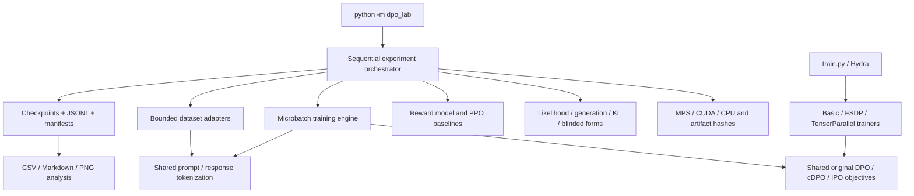

# Architecture and invariants

The original Hydra interface and distributed trainer classes remain available. The new `dpo_lab` package supplies reproducible local research orchestration. Both paths import the **same** preference loss and response-likelihood implementation.

## Mathematical contract

For each prompt and chosen/rejected completion, the engine computes response-only causal log-likelihood. Prompt labels and padding are `-100`; logits are shifted one token left. DPO uses sequence **sums**, with EOS included. IPO uses response-token **means**. The SFT objective preserves the original repository's mean of sequence negative log-likelihoods. This differs from averaging equally over every token across the batch and is deliberate.

The fixed reference is the exact saved SFT checkpoint for that task and seed. It is frozen with dropout disabled. A cache contains chosen/rejected sums and means, keyed by a digest over checkpoint identity, token IDs and masks. Cached and live-reference gradients are tested for equivalence. The reference model moves to CPU during offline preference training and returns to MPS for generation/KL evaluation.

Microbatch losses are scaled by their actual example count divided by the current logical batch size. Short final batches are consumed. Gradient clipping and optimizer updates occur once per logical batch. On distributed legacy trainers, incomplete batches that cannot be evenly split are skipped so collective tensor sizes remain valid.

## Reproducibility and restart

- Data is sampled with a fixed seed and a bounded streaming shuffle. Each selected JSONL and checkpoint is SHA-256 hashed.
- Model and dataset Hub revisions are pinned in run metadata. The OpenAI comparison dataset uses pinned converted Parquet files, avoiding executable dataset loading scripts.
- Each stage writes per-step metrics and a completion receipt. `--resume` verifies receipts and skips completed stages.
- Restart granularity is **one training stage**. Interrupted stages rerun from their input model; the engine does not claim exact mid-epoch optimizer/RNG recovery.
- Changing the source or requested configuration invalidates automatic reuse. Use a new output directory for changed experiments.
- MPS runs are seeded, but cross-version or cross-device bitwise reproducibility is not guaranteed.
- DPO updates do not sample model responses or train a reward model. The explicit reward and PPO paths exist only for comparison experiments.

## Apple Silicon choices

FP32 parameters avoid unsupported or hardware-specific mixed-precision assumptions on M1. Eager attention is used for a consistent CPU/MPS execution path. Small logical batches are accumulated from microbatches. RMSprop retains the upstream memory-efficient optimizer choice. Optional activation checkpointing trades compute for activation memory. No quantization, LoRA, or changed DPO objective is silently applied.

Network access is necessary only for initial public data/model downloads. The smoke profile builds its tokenizer and transformer locally and works offline after dependency installation. CUDA-only tensor parallelism is imported only when requested. W&B is disabled by default; local evidence does not depend on an account.
