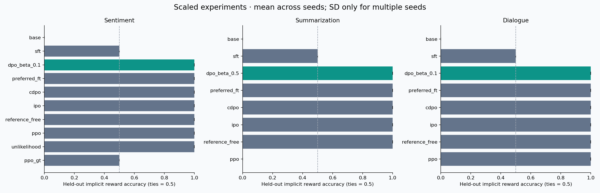
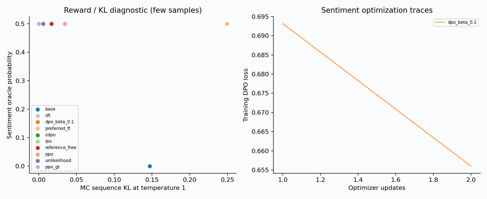

# Experiment report

Scope: **synthetic engineering smoke test**. Status: **completed**.

Device: `mps`; model: `fixture`; seeds: `[0]`.

These measurements do not reproduce the paper-scale results. GPT-4 and human judgments have not been collected.
Held-out preference accuracy measures the implicit reward ordering of provided pairs, not generated-answer quality.
Ties receive 0.5. The SFT reference therefore scores exactly 0.5 by construction; that is not a generation win rate.

| Task | Method | Seeds | Accuracy mean ± SD | Reward margin | Chosen NLL/token |
|---|---|---:|---:|---:|---:|
| sentiment | base | 1 | 0.000 ± not estimated | -0.251 | 4.142 |
| sentiment | sft | 1 | 0.500 ± not estimated | 0.000 | 3.280 |
| sentiment | dpo_beta_0.1 | 1 | 1.000 ± not estimated | 0.202 | 3.268 |
| sentiment | preferred_ft | 1 | 1.000 ± not estimated | 0.048 | 3.123 |
| sentiment | cdpo | 1 | 1.000 ± not estimated | 0.202 | 3.268 |
| sentiment | ipo | 1 | 1.000 ± not estimated | 0.202 | 3.268 |
| sentiment | reference_free | 1 | 1.000 ± not estimated | 0.202 | 3.268 |
| sentiment | ppo | 1 | 1.000 ± not estimated | 0.010 | 3.346 |
| sentiment | unlikelihood | 1 | 1.000 ± not estimated | 0.074 | 3.150 |
| sentiment | ppo_gt | 1 | 0.500 ± not estimated | 0.000 | 3.280 |
| summarization | base | 1 | 0.000 ± not estimated | -3.110 | 4.177 |
| summarization | sft | 1 | 0.500 ± not estimated | 0.000 | 3.325 |
| summarization | dpo_beta_0.5 | 1 | 1.000 ± not estimated | 1.298 | 3.249 |
| summarization | preferred_ft | 1 | 1.000 ± not estimated | 0.699 | 3.134 |
| summarization | cdpo | 1 | 1.000 ± not estimated | 1.298 | 3.249 |
| summarization | ipo | 1 | 1.000 ± not estimated | 1.293 | 3.259 |
| summarization | reference_free | 1 | 1.000 ± not estimated | 1.298 | 3.249 |
| summarization | ppo | 1 | 0.000 ± not estimated | -0.402 | 3.401 |
| dialogue | base | 1 | 0.000 ± not estimated | -0.713 | 4.203 |
| dialogue | sft | 1 | 0.500 ± not estimated | 0.000 | 3.389 |
| dialogue | dpo_beta_0.1 | 1 | 1.000 ± not estimated | 0.246 | 3.299 |
| dialogue | preferred_ft | 1 | 1.000 ± not estimated | 0.127 | 3.174 |
| dialogue | cdpo | 1 | 1.000 ± not estimated | 0.246 | 3.299 |
| dialogue | ipo | 1 | 1.000 ± not estimated | 0.246 | 3.307 |
| dialogue | reference_free | 1 | 1.000 ± not estimated | 0.246 | 3.299 |
| dialogue | ppo | 1 | 1.000 ± not estimated | 0.011 | 3.409 |

## Observed default-DPO comparisons

- **sentiment**: default DPO pair accuracy 1.000 (seed SD not estimated), versus the SFT identity baseline 0.500 and Preferred-FT 1.000. Chosen NLL/token changes from 3.280 to 3.268. These are held-out likelihood diagnostics, not evaluator win rates.
- **summarization**: default DPO pair accuracy 1.000 (seed SD not estimated), versus the SFT identity baseline 0.500 and Preferred-FT 1.000. Chosen NLL/token changes from 3.325 to 3.249. These are held-out likelihood diagnostics, not evaluator win rates.
- **dialogue**: default DPO pair accuracy 1.000 (seed SD not estimated), versus the SFT identity baseline 0.500 and Preferred-FT 1.000. Chosen NLL/token changes from 3.389 to 3.299. These are held-out likelihood diagnostics, not evaluator win rates.

## Interpretation

Compare DPO with SFT and Preferred-FT within each task. Inspect per-seed dispersion and the per-example bootstrap intervals in each `evaluation/summary.json` before drawing conclusions. Preference pairs sharing a prompt are correlated, so the example bootstrap can underestimate uncertainty. With this small corpus and few generations, these are workflow and optimization diagnostics, not statistically powered algorithm rankings.

The sentiment reward/KL plot uses untempered policy samples (temperature 1, no top-k/top-p filtering). KL is the sum of exact conditional vocabulary KL values along sampled prefixes; averaging these is a Monte Carlo sequence-KL estimate. Other temperatures and Best-of-N are not mislabeled as policy KL.

For summaries and dialogue, learned reward scores and lexical overlap are diagnostics. The same learned reward selects Best-of-N and scores its candidates, so those scores are not independent evidence of quality. Blinded forms are exported for external evaluation; unfilled forms are not counted as judgments.

## Reproducibility

`manifest.json` records the configuration, source hash, package versions, model revisions, and scope. `data/manifest.json` records source revisions and exact selected-file SHA-256 hashes. Per-stage completion receipts hash checkpoints and evaluation artifacts. Reference caches bind token IDs and labels to the frozen SFT checkpoint hash.

Run `python -m dpo_lab run --config <same config> --output <this directory> --resume` to validate and reuse completed stages. An interrupted stage restarts from its input checkpoint; mid-step optimizer/RNG restoration is not implemented.

## Remaining paper-scale work

The original GPT-2-large / GPT-J / Pythia-2.8B models, full data volumes and convergence sweeps, original RoBERTa-large sentiment oracle, TRL PPO-GT comparison and tuned PPO settings, GPT-4-0314 judgments, and human agreement study have not been reproduced in this local run. See `../../docs/PAPER_REPRODUCTION.md` for the coverage matrix.
